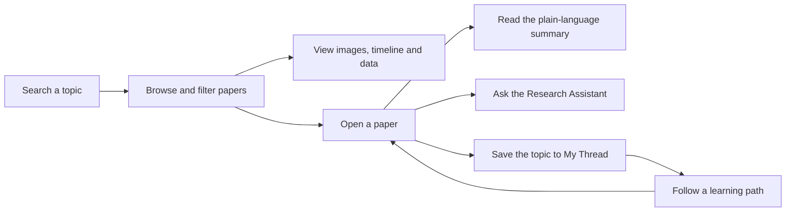
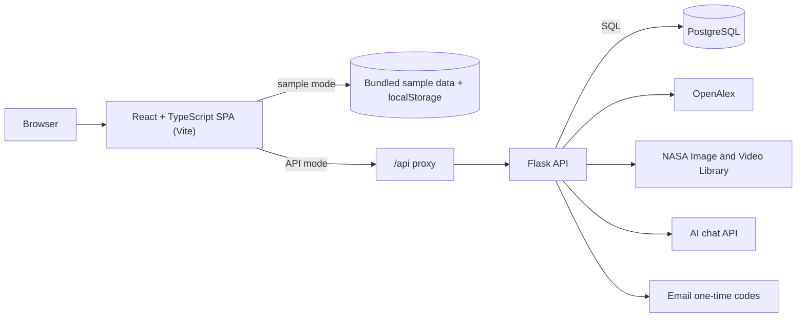
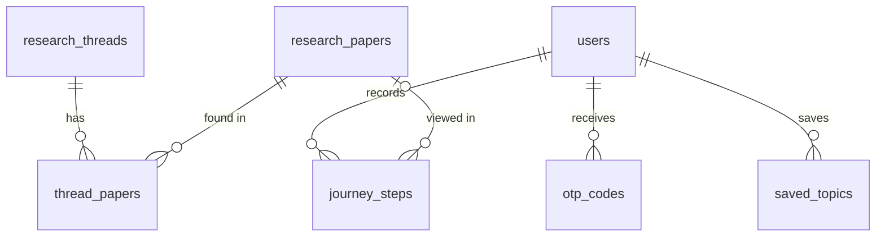

# AstroThread · Research Explorer

**A scientific research discovery platform for astronomy and physics.
Holberton School, Stage 4 (MVP Development).**

  ---------------- -------------------------------------------------------------------------------------------------------------------------------------------------------------------------------------------------------------------------------------
  **Repository**   [GitHub Repository](https://github.com/Bothainakb/holberton-AstroThread)

  **Final          Branch [`AstroThread-new`](https://github.com/Bothainakb/holberton-AstroThread/tree/AstroThread-new), folder [`AstroThread-new/`](https://github.com/Bothainakb/holberton-AstroThread/tree/AstroThread-new/AstroThread-new). Latest
  submission       inspected commit: `0d46689` (2026-11-21).
  version**        

  **Backend API**  [Health Check](https://astrothread-api.vercel.app/api/health)

  **Production     [AstroThread](https://astrothread-six.vercel.app/). **Important:** This URL currently serves the older `main` version, not `AstroThread-new`. See [Production Environment](#13-production-environment).
  frontend**       

  **UI prototype   [AstroThread Research Explorer ---
  (Figma)**        Prototype](https://www.figma.com/proto/5NnyTCEOvJdC5YbM9ZnxM6/AstroThread-Research-Explorer-%E2%80%94-Prototype?node-id=2-3&t=fdl21QCf0NDZQCO2-0&scaling=min-zoom&content-scaling=fixed&page-id=0%3A1&starting-point-node-id=2%3A3)

  **Task board**   GitHub Projects --- **Board link to be added**. See [Sprint Planning](#6-sprint-planning).
  ---------------- -------------------------------------------------------------------------------------------------------------------------------------------------------------------------------------------------------------------------------------

> **Project status summary --- 2026-11-21**
>
> -   **Frontend:** MVP screens are implemented and can run using
>     bundled sample data.
> -   **Backend:** Core endpoints are implemented and have unit tests.
>     Development is not complete; one unit test fails at the latest
>     inspected commit, and some features still store data only in the
>     browser.
> -   **Production:** The deployed frontend is the older version. The
>     final `AstroThread-new` frontend is not deployed yet.
> -   **Testing:** A 72-case manual test plan exists, but no manual or
>     end-to-end tests have been executed.
> -   **Stage 4 records:** Formal sprint reviews, retrospectives, and
>     bug reports are not documented yet.

------------------------------------------------------------------------

## Table of Contents

1.  [Project Overview](#1-project-overview)
2.  [Main Features](#2-main-features)
3.  [Technology Stack](#3-technology-stack)
4.  [Project Architecture](#4-project-architecture)
5.  [Installation and Setup](#5-installation-and-setup)
6.  [Sprint Planning](#6-sprint-planning)
7.  [Sprint Reviews](#7-sprint-reviews)
8.  [Retrospectives](#8-retrospectives)
9.  [Source Repository](#9-source-repository)
10. [Bug Tracking](#10-bug-tracking)
11. [Testing Evidence and Results](#11-testing-evidence-and-results)
12. [End-to-End Testing](#12-end-to-end-testing)
13. [Production Environment](#13-production-environment)
14. [Database](#14-database)
15. [API Documentation](#15-api-documentation)
16. [Team Contributions](#16-team-contributions)
17. [Known Limitations and Future
    Improvements](#17-known-limitations-and-future-improvements)
18. [UI/UX Design and Prototype](#18-uiux-design-and-prototype)
19. [Stage 4 Deliverables Checklist](#19-stage-4-deliverables-checklist)

------------------------------------------------------------------------

## 1. Project Overview

**What it is.** AstroThread is a web application that turns a search on
an astronomy or physics topic into a starting point for learning:
relevant research papers, plain-language summaries, NASA images, and a
personal learning path.

**The problem.** Research on topics such as black holes, gravitational
waves, or exoplanets is spread across thousands of specialist papers.
Non-experts may struggle to know where to start, which papers matter,
and how ideas connect.

**Target users.** Students, science enthusiasts, and self-learners who
want to explore real research. Administrators manage user accounts.

**Main purpose.** Make scientific research approachable by connecting
search, papers, images, and guided learning in one place, using
scholarly data from OpenAlex and public NASA media.

**Research discovery workflow**



## 2. Main Features

The frontend has two data modes, controlled by `VITE_SEARCH_SOURCE`:

-   **API mode** (`api`): Calls the Flask backend.
-   **Sample mode** (any other value): Uses bundled sample papers and
    images and stores data in the browser. No backend is required.

### Status labels

  -----------------------------------------------------------------------
  Label                               Meaning
  ----------------------------------- -----------------------------------
  **Implemented**                     Frontend and backend are connected,
                                      and backend unit tests exist.
                                      Manual and end-to-end verification
                                      is not yet complete.

  **Frontend only**                   UI is implemented; data comes from
                                      static files or browser storage
                                      (`localStorage`).

  **In progress**                     Code exists but is new, partially
                                      tested, or not verified end to end.

  **Backend only**                    Endpoint exists and is tested, but
                                      no frontend page uses it.

  **Not implemented**                 No implementation exists yet.
  -----------------------------------------------------------------------

### Feature status

  ---------------------------------------------------------------------------------------
  Feature           Status            Data source in API mode         Details
  ----------------- ----------------- ------------------------------- -------------------
  Home page         Implemented       Backend                         Search box, popular
                                      (`/api/topics/popular`) +       topics, recent
                                      browser (recent searches)       searches (max 5).

  Search and        Implemented       Backend (`/api/search`,         5 results per page,
  filtering                           OpenAlex)                       year and paper-type
                                                                      filters, sorting,
                                                                      related topics,
                                                                      keyword chips,
                                                                      empty and error
                                                                      states.

  Research papers   Implemented       Backend; papers cached in       Up to 20 Physics &
                                      PostgreSQL for 7 days per topic Astronomy articles
                                                                      per search.

  Paper Details     Implemented       Backend (`/api/papers/<id>`,    Summary, key
                                      `/related`)                     findings, method,
                                                                      why it matters,
                                                                      keywords, related
                                                                      papers, and
                                                                      citation copying.

  NASA images       Implemented       Backend (`/api/images`)         Images tab, preview
                                                                      dialog, and link to
                                                                      NASA.

  Timeline and data Frontend only     Computed in the browser from    Timeline tab and
  visualizations                      search results                  Data tab (papers by
                                                                      decade, research
                                                                      type, and top
                                                                      journals).

  Topic answer      Frontend only     Static file                     Quick answers for
  cards                               `src/data/topicAnswers.ts`      Black Holes,
                                                                      Gravitational
                                                                      Waves, and
                                                                      Exoplanets.

  Research          Implemented       Backend                         Quick and free
  Assistant                           (`/api/papers/<id>/ask`);       questions; papers
                                      sign-in required                from built-in paths
                                                                      are answered from
                                                                      saved details.

  User              Implemented       Backend (`/api/auth/*`)         Passwordless
  authentication                                                      sign-up and log-in
                                                                      with a 6-digit
                                                                      email code;
                                                                      suspended-account
                                                                      handling.

  My Thread:        Implemented       Browser copy synced to          Saved topics,
  topics, journey,                    `/api/my-thread`                search and paper
  notes                                                               steps, and notes.

  My Thread:        Frontend only     Static file                     Paths for 3 topics,
  learning paths                      `src/data/learningPaths.ts`     progress, Overview
  and map                                                             / Journey / Map
                                                                      views.

  My Thread: read   Frontend only     Browser only                    Mark path papers as
  checkboxes                                                          read; not synced to
                                                                      the backend.

  Learning-path     In progress       Backend (`/api/papers/lookup`)  Added 2026-11-21;
  paper lookup                                                        matches path papers
                                                                      to live papers by
                                                                      title, with a
                                                                      bundled-data
                                                                      fallback.

  Profile           Implemented       Backend (`PATCH` / `DELETE`     Edit name, activity
                                      `/api/auth/me`) + browser       summary, clear
                                                                      search history, and
                                                                      delete account.

  Admin Dashboard:  Implemented       Backend (`/api/admin/users`)    List accounts,
  accounts                                                            suspend and
                                                                      reactivate users.

  Admin Dashboard:  Frontend only     Browser only (sample papers)    Hide, show, or
  papers and search                                                   delete papers;
  activity                                                            search statistics.

  AI topic overview Backend only      `/api/topics/<slug>/overview`   No frontend page
                                                                      calls it yet.

  Admin sign-up     Not implemented   ---                             Admin accounts can
  form                                                                be created only
                                                                      through the API
                                                                      with an invitation
                                                                      code.

  Change email or   Not implemented   ---                             Sign-in is
  password                                                            passwordless; email
                                                                      change is shown as
                                                                      available later.
  ---------------------------------------------------------------------------------------

## 3. Technology Stack

Versions are based on the project configuration files:

-   [`frontend/package.json`](https://github.com/Bothainakb/holberton-AstroThread/blob/AstroThread-new/AstroThread-new/frontend/package.json)
-   [`backend/requirements.txt`](https://github.com/Bothainakb/holberton-AstroThread/blob/AstroThread-new/AstroThread-new/backend/requirements.txt)
-   [`backend/pyproject.toml`](https://github.com/Bothainakb/holberton-AstroThread/blob/AstroThread-new/AstroThread-new/backend/pyproject.toml)

  ------------------------------------------------------------------------
  Layer                   Technology               Version
  ----------------------- ------------------------ -----------------------
  Frontend                React, React DOM         \^19.3.1

  Language                TypeScript               \~7.0.2

  Build tool / dev server Vite,                    \^8.3.6, \^6.1.2
                          `@vitejs/plugin-react`   

  Linter                  Oxlint                   \^1.90.0

  Routing                 Custom History-API       ---
                          router                   
                          (`src/lib/router.ts`)    

  Backend                 Python, Flask            ≥ 3.12, 3.1.3

  Database driver         psycopg, psycopg-binary  3.3.6

  Configuration           python-dotenv            1.2.4

  Code hashing            Werkzeug security        3.1.9
                          helpers                  

  Email                   Python `smtplib` (Gmail  Standard library
                          SMTP by default)         

  Database                PostgreSQL, raw SQL      ---
                          migrations (no ORM)      

  Backend tests           Python `unittest` and    Standard library
                          `unittest.mock`          

  External APIs           OpenAlex, NASA Image and ---
                          Video Library,           
                          OpenAI-compatible chat   
                          API (Groq by default)    

  Hosting                 Vercel                   ---

  Design                  Figma                    ---

  Project management      GitHub Projects, GitHub  ---
                          Issues                   
  ------------------------------------------------------------------------

`requirements.txt` also lists `flask-cors` and `requests`, which the
current backend code reportedly does not import.

## 4. Project Architecture



### Request flow

1.  The SPA calls relative paths such as `/api/search?q=…` (default base
    `/api`).
2.  In development, Vite proxies `/api` to `http://localhost:5000`. In
    production,
    [`frontend/vercel.json`](https://github.com/Bothainakb/holberton-AstroThread/blob/AstroThread-new/AstroThread-new/frontend/vercel.json)
    rewrites `/api/:path*` to
    `https://astrothread-api.vercel.app/api/:path*`.
3.  Because the API is served on the same origin through the rewrite,
    the Flask HttpOnly session cookie (30 days) is intended to work
    without CORS.
4.  Routes in `app/routes/` validate input and call services in
    `app/services/`, which run SQL through `app/db.py` and call external
    APIs.

**Database interaction.** `get_connection()` uses `DATABASE_URL` if set;
otherwise it uses the `DB_*` variables. A topic's papers are fetched
from OpenAlex again only after 7 days. AI-generated paper details and
topic overviews are generated once and stored.

**External integrations.** OpenAlex (search and title lookup; optional
`OPENALEX_API_KEY`), NASA Images (no key), an AI chat-completions
endpoint (`AI_API_KEY`, `AI_MODEL`, `AI_API_URL`), and SMTP. Timeouts
are 8 seconds for OpenAlex and NASA, 30 seconds for AI, and 10 seconds
for SMTP.

### Folder structure (final version)

``` text
holberton-AstroThread/            (branch AstroThread-new)
├── README.md
├── Project_Charter.md
├── Documentation.md
├── AstroThread-Technical-Documentation.md
├── PROTOTYPE_Figma.md
├── Figma.fig
├── AstroThread_Project/          # Older version; not the final submission
└── AstroThread-new/              # Final submission
    ├── backend/
    │   ├── app.py
    │   ├── wsgi.py
    │   ├── manage.py
    │   ├── pyproject.toml
    │   ├── requirements.txt
    │   ├── .env.example
    │   ├── migrations/
    │   ├── tests/
    │   └── app/
    │       ├── __init__.py
    │       ├── db.py
    │       ├── routes/
    │       └── services/
    └── frontend/
        ├── vercel.json
        ├── vite.config.ts
        ├── .env.development
        ├── .env.production
        └── src/
            ├── pages/
            ├── components/
            ├── services/
            ├── data/
            ├── lib/
            └── types/
```

## 5. Installation and Setup

### Prerequisites

Git, Node.js with npm, Python 3.12 or newer, and PostgreSQL (server plus
the `psql` / `createdb` tools).

### Clone the repository

``` bash
git clone https://github.com/Bothainakb/holberton-AstroThread.git
cd holberton-AstroThread
git checkout AstroThread-new
```

### Frontend

**macOS / Linux**

``` bash
cd AstroThread-new/frontend
npm install
npm run dev
```

For sample mode without the backend:

``` bash
VITE_SEARCH_SOURCE=sample npm run dev
```

**Windows PowerShell**

``` powershell
cd AstroThread-new\frontend
npm install
npm run dev
```

For sample mode:

``` powershell
$env:VITE_SEARCH_SOURCE = "sample"
npm run dev
```

Open the URL printed by Vite (default: `http://localhost:5173`).

In sample mode, the built-in demo sign-in accepts any email and any 6
digits. The built-in demo admin email is `admin@astrothread.demo`.

### Backend environment

**macOS / Linux**

``` bash
cd AstroThread-new/backend
python3 -m venv venv
source venv/bin/activate
pip install -r requirements.txt
cp .env.example .env
```

**Windows PowerShell**

``` powershell
cd AstroThread-new\backend
py -m venv venv
.\venv\Scripts\Activate.ps1
pip install -r requirements.txt
Copy-Item .env.example .env
```

### PostgreSQL configuration

Create an empty database. The default name is `astrothread_db`.

``` bash
createdb -U postgres astrothread_db
```

PowerShell alternative:

``` powershell
psql -U postgres -c "CREATE DATABASE astrothread_db;"
```

Set `DB_PASSWORD` (and `DB_HOST`, `DB_PORT`, `DB_NAME`, `DB_USER` if
they differ from the defaults) in `backend/.env`, or set `DATABASE_URL`.

### Database migrations and start

``` bash
python manage.py migrate
python app.py
```

The health endpoint should respond at `http://localhost:5000/api/health`
with a status response.

### Environment variables

`backend/.env` is listed in `.gitignore`. **Never commit this file.**
All values below are placeholders.

``` dotenv
DB_PASSWORD=<your-postgres-password>
SECRET_KEY=<long-random-string>
SESSION_COOKIE_SECURE=false
SMTP_USER=<sender-email>
SMTP_PASSWORD=<app-password>
# EMAIL_MODE=console
ADMIN_INVITATION_CODE=<invitation-code>
OPENALEX_API_KEY=
AI_API_KEY=<ai-provider-key>
AI_API_URL=https://api.groq.com/openai/v1/chat/completions
AI_MODEL=<model-id>
```

  -----------------------------------------------------------------------------------
  Variable                  Required          Default             Purpose
  ------------------------- ----------------- ------------------- -------------------
  `DB_PASSWORD`             Yes, unless       ---                 PostgreSQL
                            `DATABASE_URL` is                     password.
                            set                                   

  `DB_HOST`, `DB_PORT`,     No                `localhost`,        Connection
  `DB_NAME`, `DB_USER`                        `5432`,             settings.
                                              `astrothread_db`,   
                                              `postgres`          

  `DATABASE_URL`            No                ---                 Full connection
                                                                  URL; overrides
                                                                  `DB_*`.

  `SECRET_KEY`              Yes               ---                 Signs the session
                                                                  cookie.

  `SESSION_COOKIE_SECURE`   No                `false`             Set to `true` on
                                                                  HTTPS.

  `SMTP_USER`,              For real email    ---                 Sender account.
  `SMTP_PASSWORD`                                                 

  `SMTP_HOST`, `SMTP_PORT`  No                `smtp.gmail.com`,   SMTP server.
                                              `587`               

  `EMAIL_MODE`              No                ---                 `console` prints
                                                                  codes for local
                                                                  testing only.

  `ADMIN_INVITATION_CODE`   For admin sign-up ---                 Required to create
                                                                  admin accounts.

  `OPENALEX_API_KEY`        No                ---                 Sent to OpenAlex if
                                                                  set.

  `AI_API_KEY`, `AI_MODEL`  For AI features   ---                 Fall back to
                                                                  `OPENAI_API_KEY`,
                                                                  `OPENAI_MODEL`.

  `AI_API_URL`              No                Groq                Any
                                              OpenAI-compatible   OpenAI-compatible
                                              endpoint            chat endpoint.
  -----------------------------------------------------------------------------------

Frontend variables: `VITE_SEARCH_SOURCE` (`api` or `sample`) and
optional `VITE_API_BASE_URL` (default `/api`).

**Admin account in API mode.** The frontend has no admin sign-up form.
Send `POST /api/auth/signup` with
`{"fullName", "email", "accountType": "admin", "invitationCode"}`, then
`POST /api/auth/verify` with the emailed or console-printed code. After
verification, log in through the frontend.

## 6. Sprint Planning

**Tools used:** The team organizes, assigns, and tracks tasks with
**GitHub Projects** and **GitHub Issues**.

-   **Evidence of GitHub Projects usage:** Issue #14's timeline
    reportedly shows `added_to_project_v2` and
    `project_v2_item_status_changed` events (2026-10-15).
-   **Board name:** The sprint plan calls the board "AstroThread Task
    Division".
-   **Board link:** To be added by a team member.
-   **Task list:** [GitHub
    Issues](https://github.com/Bothainakb/holberton-AstroThread/issues?q=is%3Aissue).
    Issues #14--#47 are referenced by the sprint plan.

### Planning documents in the repository

  -----------------------------------------------------------------------------------------------------------------------------------------------------------------------------------------
  Document                                                                                                                                              Content
  ----------------------------------------------------------------------------------------------------------------------------------------------------- -----------------------------------
  [Sprint Plan                                                                                                                                          3 two-week sprints with dates,
  (detailed)](https://github.com/Bothainakb/holberton-AstroThread/blob/AstroThread-new/AstroThread_Project/frontend/MVP_Development_and_Execution.md)   tasks, priority, owner, dependency,
                                                                                                                                                        workflow, Definition of Done, and
                                                                                                                                                        metrics.

  [Sprint Plan (earlier                                                                                                                                 Earlier plan with 2 × 5-day sprints
  version)](https://github.com/Bothainakb/holberton-AstroThread/blob/AstroThread-new/AstroThread_Project/MVP_Development_and_Execution.md)              and three team members.

  [Project Charter](https://github.com/Bothainakb/holberton-AstroThread/blob/AstroThread-new/Project_Charter.md)                                        Timeline, scope, risks, and roles.

  [Technical Documentation](https://github.com/Bothainakb/holberton-AstroThread/blob/AstroThread-new/AstroThread-Technical-Documentation.md)            User stories, architecture, source
                                                                                                                                                        control, and QA strategy.
  -----------------------------------------------------------------------------------------------------------------------------------------------------------------------------------------

### Sprint plan summary

The following dates and objectives are taken from the detailed plan and
have not yet been reconciled with the final `AstroThread-new` scope.

  -----------------------------------------------------------------------
  Sprint            Dates             Objective         Expected
                                                        deliverables
  ----------------- ----------------- ----------------- -----------------
  Sprint 1          Oct 15 -- Oct 28, Setup, accounts,  Frontend and
                    2026              research threads, backend setup,
                                      thread details    authentication,
                                                        thread endpoints
                                                        and pages.

  Sprint 2          Oct 29 -- Nov 11, NASA media,       Research features
                    2026              papers, charts,   connected to the
                                      AI assistant      API and Postman
                                                        evidence.

  Sprint 3          Nov 12 -- Nov 25, Should Have       Bookmarks,
                    2026              features,         profile, owner
                                      integration,      dashboard,
                                      deployment, final production
                                      QA                deployment, and
                                                        end-to-end
                                                        testing.
  -----------------------------------------------------------------------

**Priorities (MoSCoW)**

-   **Must Have:** Registration and login, browsing and search, details
    and papers, timelines, NASA images, data visualizations, AI
    assistant.
-   **Should Have:** Bookmarks, profile, owner dashboard.
-   **Could Have:** Premium demo.

**Ownership and roles (from the plan):** Alaa --- Source Control
Manager; Bothaina --- Project Manager; QA --- shared.

> **Team action needed**
>
> -   The plan was written for the original `AstroThread_Project` design
>     (research threads, owner dashboard, JWT login). It was not updated
>     for `AstroThread-new`, which uses topic search, My Thread,
>     passwordless sign-in, and an admin accounts dashboard.
> -   The two plan versions disagree on team members. The detailed plan
>     lists Alaa and Bothaina; the earlier plan also lists Dana. Git
>     history reportedly contains commits from all three.
> -   Add the actual GitHub Projects board URL and update the sprint
>     plan to reflect the final scope.

## 7. Sprint Reviews

**Formal sprint review records: Not available yet.** No review notes,
demo recordings, or feedback documents were identified in the supplied
project review. The detailed sprint plan lists "Sprint 1 review and
retrospective" as To Do.

The tables below summarize work completed per sprint based on the
repository evidence described in the supplied review: closed GitHub
Issues, merged pull requests, and commit history. They are not a
substitute for formal sprint reviews, which should include the
demonstration, feedback, and action items.

### Sprint 1 (Oct 15 -- Oct 28)

  -----------------------------------------------------------------------
  Evidence                            Details
  ----------------------------------- -----------------------------------
  Issues closed in this period        #14 frontend setup, #15 pages with
                                      mock data, #16 Flask + PostgreSQL
                                      setup, #17 `/api/health` and
                                      `/api/threads` with tests, #18 Home
                                      connected to `/api/threads`, #19
                                      PostgreSQL install, #23 Stage 4
                                      roles and 6-week plan (closed
                                      2026-10-28).

  Pull requests merged                #49, #53 (Vercel config), #55
                                      (auth), #56, #60, #62 (Home page),
                                      #64 (Sign Up).

  Commits (all branches)              dana 34, Bothainakb 14, alaa2026ali
                                      7.

  Not completed in this period        Database schema (closed
                                      2026-11-04), JWT login (closed
                                      2026-11-04), thread detail
                                      endpoints (#26, open).
  -----------------------------------------------------------------------

### Sprint 2 (Oct 29 -- Nov 11)

  -----------------------------------------------------------------------
  Evidence                            Details
  ----------------------------------- -----------------------------------
  Issues closed in this period        #20 schema and seed data, #21
                                      review PR #13, #24 register, #25
                                      login, #35 NASA media connected,
                                      #36 interactive charts, #39
                                      bookmarks endpoints, #44 frontend
                                      deployment, #61 sign-up changes,
                                      #63 thread details, #66 research
                                      threads, #68 testing research and
                                      images, #76, #77, #79, #84.

  Pull requests merged                #67 (research threads), #69 (owner
                                      dashboard), #70 (profile frontend),
                                      #71 (bookmarks fix), #72 (Vercel
                                      fix), #73.

  Commits (all branches)              dana 68, alaa2026ali 15, Bothainakb
                                      9.

  Still open from the plan            #31 NASA endpoint, #32 OpenAlex
                                      import, #33 AI endpoint, #34 chart
                                      data, #37 AI assistant UI, #38
                                      Postman evidence.
  -----------------------------------------------------------------------

### Sprint 3 (Nov 12 -- Nov 25, in progress)

  -----------------------------------------------------------------------
  Evidence                            Details
  ----------------------------------- -----------------------------------
  Issues closed so far                #88 test deployment, #89 AI answer
                                      handling, #90 backend review.

  Pull requests merged                #96 (Developer → main), #97, #98
                                      (AstroThread-new → Developer), all
                                      on 2026-11-16.

  Commits so far (all branches)       dana 55, alaa2026ali 16, Bothainakb
                                      4.

  Main work (from commits)            `AstroThread-new` rebuild: search,
                                      paper details, AI summaries, OTP
                                      sign-in, My Thread, Profile, Admin
                                      accounts, Vercel API deployment,
                                      and paper lookup.

  Still open                          #43 production deployment, #45
                                      end-to-end testing, #46 manual QA
                                      review, #47 Premium demo, #80--#83,
                                      #85--#87.
  -----------------------------------------------------------------------

**Note:** Some issues were closed in batches. A closing date may
therefore be later than the actual completion date.

### Sprint review record template

Create one report per sprint, for example
`docs/sprint-reviews/sprint-1.md`.

  -----------------------------------------------------------------------
  Item                                Details to provide
  ----------------------------------- -----------------------------------
  Review date and attendees           To be completed by the team.

  Sprint goal                         To be completed by the team.

  Work completed                      Link relevant issues and PRs.

  Features demonstrated               Record what was actually
                                      demonstrated.

  Work not completed and why          Record actual blockers or
                                      unfinished work.

  Feedback received                   Record feedback actually received.

  Action items                        Include owner and due date.
  -----------------------------------------------------------------------

## 8. Retrospectives

**Retrospective records: Not available yet.** No retrospective notes
were identified in the supplied project review. This README does not
invent what went well or badly.

### Retrospective template

Create one report per sprint, for example
`docs/retrospectives/sprint-1.md`.

  -----------------------------------------------------------------------
  Question                            Team notes
  ----------------------------------- -----------------------------------
  What went well?                     To be completed by the team.

  What did not go well?               To be completed by the team.

  What challenges occurred?           To be completed by the team.

  What did we learn?                  To be completed by the team.

  What should improve in the next     Include an owner where possible.
  sprint?                             
  -----------------------------------------------------------------------

## 9. Source Repository

  ------------------------------------------------------------------------------------------------------------------------------------
  Item                                Value (based on the supplied review dated 2026-11-21)
  ----------------------------------- ------------------------------------------------------------------------------------------------
  GitHub URL                          [AstroThread Repository](https://github.com/Bothainakb/holberton-AstroThread)

  Default branch `main`               Contains the older `AstroThread_Project/` version. Last merge reported: PR #96 (2026-11-16).

  Integration branch                  [`Developer`](https://github.com/Bothainakb/holberton-AstroThread/tree/Developer)

  Final version                       [`AstroThread-new`](https://github.com/Bothainakb/holberton-AstroThread/tree/AstroThread-new),
                                      latest inspected commit `0d46689` (2026-11-21).

  Merge status                        `AstroThread-new` is not merged into `main`. PR
                                      [#98](https://github.com/Bothainakb/holberton-AstroThread/pull/98) reportedly merged it into
                                      `Developer` on 2026-11-16; later commits are reported as not yet in `Developer`.

  Pull requests                       [All pull requests](https://github.com/Bothainakb/holberton-AstroThread/pulls?q=is%3Apr).
  ------------------------------------------------------------------------------------------------------------------------------------

### Git workflow

The documented workflow is:

-   Work on a personal or feature branch (`feature/<name>`,
    `fix/<name>`, or a team member branch).
-   Open a pull request into `Developer`.
-   Have another team member review it before merging.
-   Merge tested work into `main`.
-   Keep secrets in `.env` files.

Example commands:

``` bash
git checkout AstroThread-new
git pull
git checkout -b feature/<short-name>

# Make changes, commit, and run tests.
git push -u origin feature/<short-name>

# Open a Pull Request and request a review.
```

**Note:** Recent work on `AstroThread-new` was reportedly pushed
directly to the branch without pull requests.

## 10. Bug Tracking

**Process.** The sprint plan says bugs are logged as GitHub Issues and
linked to the related task. The repository has a default [`bug`
label](https://github.com/Bothainakb/holberton-AstroThread/labels/bug).

-   [All GitHub
    Issues](https://github.com/Bothainakb/holberton-AstroThread/issues?q=is%3Aissue)
-   [Issues labelled
    `bug`](https://github.com/Bothainakb/holberton-AstroThread/issues?q=is%3Aissue+label%3Abug)

**Current state (reported as checked 2026-11-21):** Issues are used for
tasks, but no bug reports have been logged. The supplied review found no
issue carrying the `bug` label. Issue #45, "End-to-end integration
testing and bug fixing", is reported as open.

### Bug report format

Log each actual defect as a GitHub Issue with the `bug` label.

  -----------------------------------------------------------------------
  Field                               Description
  ----------------------------------- -----------------------------------
  Bug ID                              GitHub issue number.

  Description                         Short summary of the problem.

  Steps to reproduce                  Numbered steps, including mode
                                      (sample / API), URL, and commit.

  Expected result                     What should happen.

  Actual result                       What happened; attach a screenshot
                                      or console output.

  Severity                            High / Medium / Low.

  Status                              Open / In progress / Fixed /
                                      Verified / Won't fix.

  Assigned team member                GitHub username.
  -----------------------------------------------------------------------

**Known test issue identified during documentation review:** Backend
unit test
`test_lookup.FindPaperTests.test_commas_and_colons_are_removed_from_the_filter`
reportedly fails at commit `0d46689`. See [Backend Unit
Tests](#112-backend-unit-tests). This should be investigated and logged
as a bug if confirmed.

## 11. Testing Evidence and Results

> A test plan and test results are different. Only tests with recorded
> execution evidence should be reported as executed.

### 11.1 Frontend manual testing

  -----------------------------------------------------------------------
  Item                                Value
  ----------------------------------- -----------------------------------
  Test plan                           `Frontend-Manual-Testing.md`,
                                      prepared from the `AstroThread-new`
                                      frontend at commit `0d46689`.
                                      Reported as not yet pushed to
                                      GitHub.

  Planned test cases                  72: 52 in Sample Mode (FE-01 --
                                      FE-52) and 20 in API Mode
                                      (FE-API-01 -- FE-API-20).

  Executed                            0 --- all 72 are Not Run.

  Passed / Failed                     To be recorded after execution.

  Screenshots folder                  `testing-evidence/` --- reported as
                                      not created yet.
  -----------------------------------------------------------------------

For each test, record the actual result and set the status to Pass,
Fail, or Blocked. Save screenshots as
`testing-evidence/<TestID>_<description>.png`. Log confirmed failures as
GitHub Issues with the `bug` label.

### 11.2 Backend unit tests

The backend is reported to have 9 test files and 114 test methods in
[`AstroThread-new/backend/tests/`](https://github.com/Bothainakb/holberton-AstroThread/tree/AstroThread-new/AstroThread-new/backend/tests).

Run:

``` bash
cd AstroThread-new/backend
python -m unittest discover -s tests -v
```

**Results recorded during documentation review (2026-11-21):** These
runs used Python 3.13 with a minimal stand-in for `psycopg`, because the
real package could not be installed in the review environment. The team
must rerun the tests with real dependencies and save the output as
evidence.

  -------------------------------------------------------------------------------------------
  Commit                              Reported result
  ----------------------------------- -------------------------------------------------------
  `7e971b3`                           103 tests: OK.

  `71716a1`                           68 tests: FAILED (61 errors), `IndentationError` in
                                      `app/services/openalex.py`; reportedly fixed in
                                      `53ebbf7`.

  `0d46689`                           114 tests: FAILED (1 failure),
                                      `test_commas_and_colons_are_removed_from_the_filter`.
                                      The test checks that `publication_year` is absent from
                                      the URL, but the word also appears in the `select=`
                                      field list. Needs review.
  -------------------------------------------------------------------------------------------

**Postman / API testing evidence:** Issue #38 is reported as open. Issue
#68, "Testing: Research and Images", is reported as closed, but no test
output was identified in the supplied review.

### 11.3 Build and quality checks

Run these commands from `AstroThread-new/frontend`:

``` bash
npm run lint
npm run build
```

  -----------------------------------------------------------------------
  Command                 Purpose                 Reported result
  ----------------------- ----------------------- -----------------------
  `npm run lint`          Oxlint static checks    Not run / result not
                                                  recorded.

  `npm run build`         TypeScript check        Not run / result not
                          (`tsc -b`) and          recorded.
                          production build        
  -----------------------------------------------------------------------

There are no automated frontend tests reported (no test files and no
`test` script) and no CI pipeline reported.

## 12. End-to-End Testing

**Status: Not executed. No evidence is available in the supplied
review.** Issues #45 ("End-to-end integration testing and bug fixing")
and #46 ("Request manual QA review") are reported as open.

**Blocker:** The production frontend URL serves the old `main` version.
The final application cannot be tested end to end on that deployment
until `AstroThread-new` is deployed.

### Planned end-to-end scenario

Run this flow on the deployed final version using API Mode test cases
FE-API-01 -- FE-API-20 in `Frontend-Manual-Testing.md`.

  -----------------------------------------------------------------------
  Step                    User flow               Related test cases
  ----------------------- ----------------------- -----------------------
  1                       Open the deployed site  FE-API-01
                          and check `/api/health` 
                          through the site.       

  2                       Search a topic, filter, FE-API-03, FE-API-05
                          sort, paginate, and     
                          open the Images tab.    

  3                       Open a paper and check  FE-API-06, FE-API-08
                          AI summary sections and 
                          related papers.         

  4                       Sign up with a real     FE-API-09, FE-API-11
                          email code, log out,    
                          and log in again.       

  5                       Ask the Research        FE-API-12
                          Assistant a question.   

  6                       Save a topic, follow a  FE-API-13, FE-API-15
                          learning path, add a    
                          note, and check the     
                          data on a second        
                          device.                 

  7                       Edit the profile name   FE-API-16, FE-API-17
                          and delete a test       
                          account.                

  8                       As an admin, list       FE-API-18, FE-API-19
                          accounts, suspend a     
                          user, and reactivate    
                          the user.               
  -----------------------------------------------------------------------

### E2E results

Complete this table only after running the test.

  -----------------------------------------------------------------------
  Date        Tester      Frontend    Backend     Steps       Evidence
                          URL         commit      passed /    
                                                  total       
  ----------- ----------- ----------- ----------- ----------- -----------
  To be added To be added To be added To be added To be added To be added

  -----------------------------------------------------------------------

## 13. Production Environment

  -------------------------------------------------------------------------------------------------------------------------------------------------------------------------------------------------------------------------------------
  Component               URL                                                                 Reported status (2026-11-21)
  ----------------------- ------------------------------------------------------------------- -----------------------------------------------------------------------------------------------------------------------------------------
  Production frontend     [astrothread-six.vercel.app](https://astrothread-six.vercel.app/)   Serves the older `main` version (page title "AstroThread"). The final version uses the title "AstroThread · Research Explorer". This is
                                                                                              not the final application.

  `AstroThread-new`       To be added                                                         Not deployed.
  frontend                                                                                    [`frontend/vercel.json`](https://github.com/Bothainakb/holberton-AstroThread/blob/AstroThread-new/AstroThread-new/frontend/vercel.json)
                                                                                              is reported as configured for a Vite build, `dist/`, and an `/api` rewrite to the deployed API.

  Backend API             [Health Check](https://astrothread-api.vercel.app/api/health)       Reported as responding. `health`, `topics/popular`, `search`, `images`, and `papers/1` returned JSON during the review. Deployed commit
                                                                                              is not recorded.

  Database                Hosted PostgreSQL connected to the API                              Reported as working. Provider and migration state are not documented.
  -------------------------------------------------------------------------------------------------------------------------------------------------------------------------------------------------------------------------------------

**Intended deployment architecture:** A Vercel static frontend whose
`/api/*` requests are rewritten to the Vercel Python backend, which uses
hosted PostgreSQL and external APIs.

**Host configuration:** Set backend environment variables from
Environment Variables in Vercel, especially `DATABASE_URL`,
`SECRET_KEY`, `SESSION_COOKIE_SECURE=true`, SMTP settings, `AI_API_KEY`,
`AI_MODEL`, and `ADMIN_INVITATION_CODE`. The frontend needs
`VITE_SEARCH_SOURCE=api`, which is reported as present in
`.env.production`.

**Limitations:** The final frontend is not deployed; production email
sign-in is not verified; migrations are applied manually; and there is
no deployment pipeline.

## 14. Database

The application uses **PostgreSQL**, accessed with psycopg and raw SQL.
Six migrations in
[`AstroThread-new/backend/migrations/`](https://github.com/Bothainakb/holberton-AstroThread/tree/AstroThread-new/AstroThread-new/backend/migrations)
reportedly create seven tables.

### Migrations

  -----------------------------------------------------------------------
  Migration                           Creates / changes
  ----------------------------------- -----------------------------------
  `001_create_tables.sql`             `research_threads`,
                                      `research_papers`, `thread_papers`.

  `002_topic_overview.sql`            `research_threads.overview`,
                                      `overview_generated_at`.

  `003_paper_details.sql`             Paper venue, topic, keywords,
                                      author list, method, main finding,
                                      why it matters, and generation
                                      timestamp fields.

  `004_create_users.sql`              `users`, `otp_codes`.

  `005_my_thread.sql`                 `saved_topics`, `journey_steps`.

  `006_account_status.sql`            `users.status` (`active` /
                                      `suspended`).
  -----------------------------------------------------------------------

### Database tables

  -----------------------------------------------------------------------
  Table                   Purpose                 Key columns
  ----------------------- ----------------------- -----------------------
  `research_threads`      One row per searched    `slug`, `title`,
                          topic                   `search_count`,
                                                  `last_searched_at`,
                                                  `papers_fetched_at`,
                                                  `overview`.

  `research_papers`       Papers cached from      `openalex_id`, `title`,
                          OpenAlex                `authors`,
                                                  `publication_year`,
                                                  `abstract`, `url`,
                                                  `cited_by_count`, AI
                                                  detail fields.

  `thread_papers`         Papers found for a      Primary key
                          topic                   (`thread_id`,
                                                  `paper_id`), `rank`.

  `users`                 Accounts without        `full_name`, `email`,
                          passwords               `account_type`,
                                                  `email_verified_at`,
                                                  `status`.

  `otp_codes`             One-time codes          `user_id`, `code_hash`,
                                                  `expires_at`,
                                                  `attempts`, `used_at`.

  `saved_topics`          My Thread topics        `user_id`, `topic`
                                                  (unique per user,
                                                  case-insensitive).

  `journey_steps`         My Thread journey       `user_id`, `step_key`,
                                                  `step_type`, `query`,
                                                  `paper_id`, `topic`,
                                                  `note`.
  -----------------------------------------------------------------------



All foreign keys are reported to use `ON DELETE CASCADE`. See
[Installation and Setup](#5-installation-and-setup) for PostgreSQL
configuration.

## 15. API Documentation

Endpoints are defined in
[`AstroThread-new/backend/app/routes/`](https://github.com/Bothainakb/holberton-AstroThread/tree/AstroThread-new/AstroThread-new/backend/app/routes).
Errors use a JSON response such as `{"error": "…"}`.

**Authentication labels:** Public = no sign-in required; Login required
= signed-in user (otherwise 401); Admin only = active admin account
(otherwise 403).

### Implemented endpoints (backend unit tests reported)

  ------------------------------------------------------------------------------------------
  Method            Endpoint                             Auth              Purpose
  ----------------- ------------------------------------ ----------------- -----------------
  GET               `/api/health`                        Public            Health check.

  GET               `/api/topics/popular`                Public            Most-searched
                                                                           topics.

  GET               `/api/search?q=`                     Public            Search papers
                                                                           through OpenAlex;
                                                                           cached for 7
                                                                           days.

  GET               `/api/images?q=`                     Public            NASA image
                                                                           search.

  GET               `/api/papers/<int:id>`               Public            Paper details; AI
                                                                           fields generated
                                                                           once.

  GET               `/api/papers/<int:id>/related`       Public            Related papers
                                                                           from the
                                                                           database.

  POST              `/api/papers/<int:id>/ask`           Login required    Ask the AI about
                                                                           a paper
                                                                           (`question`,
                                                                           3--300
                                                                           characters).

  POST              `/api/auth/signup`                   Public            Create an account
                                                                           and email a code;
                                                                           admin sign-up
                                                                           requires an
                                                                           invitation code.

  POST              `/api/auth/login`                    Public            Email a code to a
                                                                           verified account.

  POST              `/api/auth/verify`                   Public            Verify a code and
                                                                           start a session.

  GET               `/api/auth/me`                       Public            Current user, or
                                                                           401.

  PATCH             `/api/auth/me`                       Login required    Change full name.

  DELETE            `/api/auth/me`                       Login required    Delete own
                                                                           account.

  POST              `/api/auth/logout`                   Public            End the session.

  GET               `/api/my-thread`                     Login required    Saved topics and
                                                                           journey steps.

  POST / DELETE     `/api/my-thread/topics`,             Login required    Save or remove a
                    `/api/my-thread/topics/<topic>`                        topic.

  POST / PATCH /    `/api/my-thread/steps`,              Login required    Add a step, set a
  DELETE            `/api/my-thread/steps/<step_key>`                      note, or remove a
                                                                           step.

  GET               `/api/admin/users`                   Admin only        List verified
                                                                           accounts.

  PATCH             `/api/admin/users/<int:id>/status`   Admin only        Suspend or
                                                                           reactivate
                                                                           non-admin users.
  ------------------------------------------------------------------------------------------

### In progress or not connected

  -----------------------------------------------------------------------------------------
  Method            Endpoint                            Auth              Status
  ----------------- ----------------------------------- ----------------- -----------------
  GET               `/api/papers/lookup?title=&year=`   Public            In progress.
                                                                          Added 2026-11-21
                                                                          and used by
                                                                          learning-path
                                                                          links. Reported
                                                                          to have 11 unit
                                                                          tests, one
                                                                          failing, and not
                                                                          verified on
                                                                          deployment.

  GET               `/api/topics/<slug>/overview`       Public            Backend only.
                                                                          Implemented and
                                                                          tested; no
                                                                          frontend page
                                                                          calls it.
  -----------------------------------------------------------------------------------------

**Not available:** Endpoints for admin paper moderation, admin search
statistics, learning-path content, read marks, and recent searches.

## 16. Team Contributions

The following counts and areas are based on the Git history summary
supplied for the `AstroThread-new` branch, reportedly counted on
2026-11-21. Git author names are used as shown in the history.

  ------------------------------------------------------------------------
  Git author                                 Commits Main areas
  --------------------- ---------------------------- ---------------------
  `dana`                                         115 Backend search,
                                                     OpenAlex, AI service,
                                                     paper and lookup
                                                     endpoints,
                                                     migrations, backend
                                                     tests, Vercel
                                                     deployment
                                                     configuration,
                                                     learning-path lookup,
                                                     and frontend read
                                                     marks.

  `alaa2026ali`                                   27 Frontend Search page
                                                     and tabs, Images tab,
                                                     My Thread, learning
                                                     paths, knowledge map,
                                                     Profile, Admin
                                                     dashboard, 404 page,
                                                     Home, header, and
                                                     branding.

  `Bothainakb`                                     7 OTP sign-in backend,
                                                     users and OTP
                                                     migration, resend
                                                     wait, profile name
                                                     and account deletion,
                                                     account suspension,
                                                     and admin routes.
  ------------------------------------------------------------------------

**Roles stated in the sprint plan:** Alaa --- Source Control Manager;
Bothaina --- Project Manager; QA --- shared.

### To be confirmed by the team

-   Full names for each Git account.
-   Dana's Stage 4 role.
-   The owner of GitHub account `1334hue`, which is assigned to many
    issues and has its own branch.

## 17. Known Limitations and Future Improvements

### Backend work in progress

-   `/api/papers/lookup` is new, has one reported failing unit test, and
    has not been verified end to end.
-   The AI topic overview endpoint is not used by any page.

### Features using sample or browser-only data

-   Admin papers list, hide / delete actions, and search statistics.
-   Learning paths and topic answer cards (static files).
-   Learning-path read checkboxes and recent searches (`localStorage`).

### Missing integrations

-   No backend endpoints for admin paper moderation, search statistics,
    or read marks.
-   No admin sign-up form.
-   No email or password change feature.

### Deployment limitations

-   The production frontend URL serves the old version.
-   The `AstroThread-new` frontend is not deployed.
-   The deployed backend commit and database migration state are not
    recorded.
-   A local frontend may be unable to call the deployed API directly
    because of CORS configuration; verify the actual deployment path
    before relying on this statement.

### Testing gaps

-   No frontend automated tests and no CI pipeline are reported.
-   Manual and end-to-end tests have not been executed.
-   No Postman evidence is available.
-   Lint and build results are not recorded.

### Other findings

-   Unused packages are listed in `requirements.txt`.
-   `DATABASE_URL` is missing from `.env.example`.
-   The sprint plan does not match the final scope.
-   `PROTOTYPE_Figma.md` still links to the old Figma prototype.

### Future improvements

-   Connect the AI topic overview endpoint to the frontend.
-   Store read marks and admin moderation data on the server.
-   Add frontend tests and CI.
-   Add more learning paths from backend data.
-   Rate-limit AI endpoints.
-   Complete the Premium demo if time allows.

## 18. UI/UX Design and Prototype

  -------------------------------------------------------------------------------------------------------------------------------------------------------------------------------------------------------------------------------------------------------------------------
  Item                                Link
  ----------------------------------- -------------------------------------------------------------------------------------------------------------------------------------------------------------------------------------------------------------------------------------
  Interactive prototype (current)     [AstroThread Research Explorer ---
                                      Prototype](https://www.figma.com/proto/5NnyTCEOvJdC5YbM9ZnxM6/AstroThread-Research-Explorer-%E2%80%94-Prototype?node-id=2-3&t=fdl21QCf0NDZQCO2-0&scaling=min-zoom&content-scaling=fixed&page-id=0%3A1&starting-point-node-id=2%3A3)

  Figma file in the repository        [`Figma.fig`](https://github.com/Bothainakb/holberton-AstroThread/blob/AstroThread-new/Figma.fig)

  Older prototype note                [`PROTOTYPE_Figma.md`](https://github.com/Bothainakb/holberton-AstroThread/blob/AstroThread-new/PROTOTYPE_Figma.md) --- links to the earlier prototype.
  -------------------------------------------------------------------------------------------------------------------------------------------------------------------------------------------------------------------------------------------------------------------------

The prototype shows the interface and navigation flow. It does not
include backend behaviour and may differ from the implemented screens.

## 19. Stage 4 Deliverables Checklist

  ------------------------------------------------------------------------------------------------------------------------------------------------------------------------------------------------
  Deliverable             Status                  Evidence / remaining work
  ----------------------- ----------------------- ------------------------------------------------------------------------------------------------------------------------------------------------
  Sprint Planning         Partial                 [Sprint
                                                  plan](https://github.com/Bothainakb/holberton-AstroThread/blob/AstroThread-new/AstroThread_Project/frontend/MVP_Development_and_Execution.md),
                                                  [GitHub Issues](https://github.com/Bothainakb/holberton-AstroThread/issues?q=is%3Aissue). Add the GitHub Projects board link and update the plan
                                                  to match the final scope.

  Sprint Reviews          Missing                 Work-completion evidence is summarized in Sprint Reviews. Formal review reports still need to be added.

  Retrospectives          Missing                 Add a retrospective report for each sprint using actual team feedback.

  Source Repository       Partial                 [GitHub Repository](https://github.com/Bothainakb/holberton-AstroThread). The final branch `AstroThread-new` is not yet merged into `main`,
                                                  according to the supplied review.

  Bug Tracking            Partial                 The process and `bug` label exist, but no bug reports were identified in the supplied review. Log confirmed defects as issues.

  Testing Evidence and    Partial                 Backend tests are reported as 114 with one failing; rerun with real dependencies. Manual plan has 72 cases and zero executed. Add screenshots,
  Results                                         Postman evidence, lint and build results.

  End-to-End Testing      Missing                 Not executed. Run on the deployed final version and record evidence.

  Production Environment  Partial                 Backend API is reported live; the final frontend is not deployed. Deploy and verify `AstroThread-new`.
  ------------------------------------------------------------------------------------------------------------------------------------------------------------------------------------------------

### Remaining actions

-   [ ] Sprint Planning: add the GitHub Projects board link and update
    the plan.
-   [ ] Sprint Reviews: add a review report for each sprint.
-   [ ] Retrospectives: add a retrospective report for each sprint.
-   [ ] Source Repository: review and merge the final version into
    `main` if required by the team workflow.
-   [ ] Bug Tracking: test error scenarios and log confirmed bugs with
    the `bug` label.
-   [ ] Testing Evidence and Results: run the tests and add the
    evidence.
-   [ ] End-to-End Testing: run the full flow on the deployed final
    version.
-   [ ] Production Environment: deploy and verify the `AstroThread-new`
    frontend.

------------------------------------------------------------------------

This README describes the `AstroThread-new` version based on the project information supplied for commit `0d46689`.

The reported review date is 2026-11-21. Items marked as pending must be verified and completed by the team before final submission.
